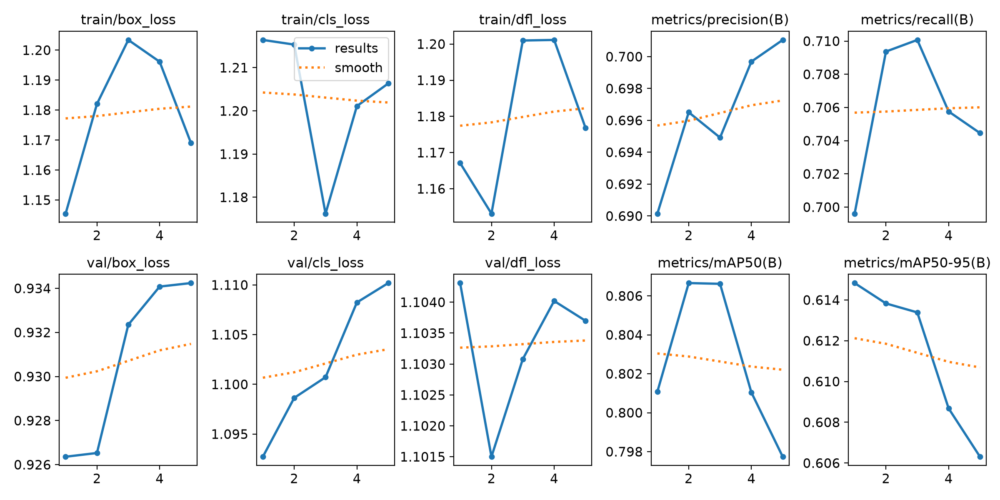
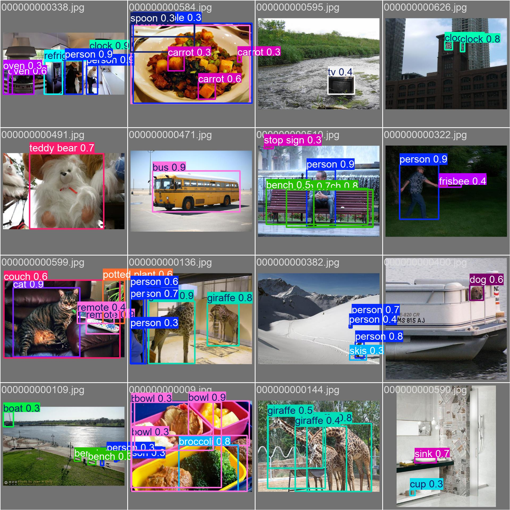
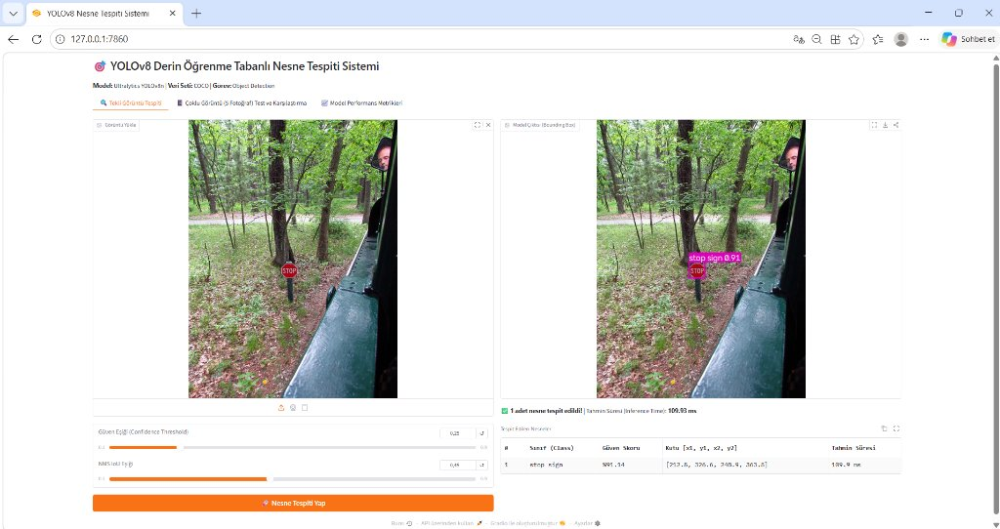
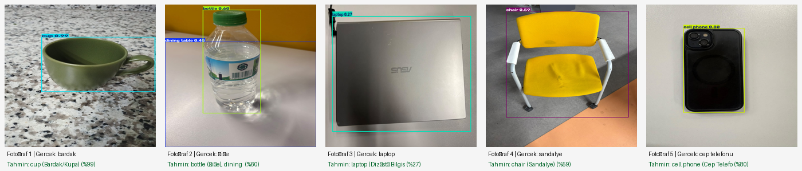

# 🎯 DERİN ÖĞRENME – PROJE RAPORU
## YOLOv8 Mimarisi ile Nesne Tespiti (Object Detection) Uygulaması

---

## 1. Projenin Amacı ve Seçilen Görev (Task)
Bu çalışmada, açık kaynaklı **COCO** veri seti kullanılarak **Nesne Tespiti (Object Detection)** problemi üzerine derin öğrenme tabanlı bir model geliştirilmiştir. Yalnızca görüntüde ne olduğunu söyleyen görüntü sınıflandırmadan farklı olarak nesne tespiti; görüntü içerisindeki birden fazla nesnenin hem sınıfını tahmin etmekte hem de konumunu sınırlayıcı kutular (*bounding box*) ile belirlemektedir. Gerçek hayat uygulamalarında (otonom sürüş, güvenlik sistemleri, akıllı kameralar) en kritik görevlerden biri olması sebebiyle bu problem seçilmiştir.

---

## 2. Veri Seti (Dataset) ve Seçim Gerekçesi
- **Kullanılan Veri Seti:** COCO (*Common Objects in Context* - COCO128 Alt Kümesi)
- **Veri Seti URL:** https://cocodataset.org/
- **Neden COCO Veri Seti Seçildi?:** COCO veri seti, günlük hayatta sıkça karşılaşılan 80 farklı nesne sınıfını (insan, araba, trafik/dur levhası, bardak, şişe, sandalye, bilgisayar, kedi, köpek vb.) farklı aydınlatma, açı ve karmaşık arka plan koşullarında içermektedir. Bu çeşitlilik, modelin gerçek dünya görüntülerinde ve telefon kamerası ile çekilen fotoğraflarda yüksek genelleme başarımı göstermesini sağlamaktadır.
- **Eğitim, Doğrulama ve Test Ayrımı:** Modelin ezberlemesini (*overfitting*) önlemek ve genelleme yeteneğini objektif biçimde ölçmek amacıyla veri seti rastgele (`seed=42`) olarak **%70 Eğitim (88 görüntü)**, **%15 Doğrulama (18 görüntü)** ve **%15 Test (20 görüntü)** kümelerine ayrılmıştır (`1_veri_hazirla.py`).

---

## 3. Model Mimarisi, Eğitim Ayarları ve Seçim Gerekçeleri

### A) Model Mimarisi: Ultralytics YOLOv8n (Nano) ve Seçim Gerekçesi
R-CNN ve Faster R-CNN gibi iki aşamalı (*two-stage*) dedektörler bölge önerisi ve sınıflandırmayı ayrı aşamalarda yaptığı için yüksek işlem süresi gerektirir. **YOLOv8** ise tek aşamalı (*single-stage*) ve çapasız (*anchor-free*) modern bir mimaridir. **CSPDarknet53** tabanlı *Backbone*, çok ölçekli öznitelik birleştiren **PAN-FPN** *Neck* ve sınıflandırma ile kutu regresyonunu birbirinden ayıran **Decoupled Head** yapısı sayesinde hem çok hızlı çıkarım (*inference*) yapmakta hem de küçük nesnelerde yüksek doğruluk sağlamaktadır. Nano (`YOLOv8n` - 3.15M parametre) varyantı, CPU ortamında dahi hızlı eğitilebilmesi ve gerçek zamanlı çalışabilmesi nedeniyle tercih edilmiştir.

### B) Hiperparametreler ve Seçim Gerekçeleri
- **Giriş Boyutu (`Input Size = 640x640x3`):** Görüntüdeki küçük ve uzak nesnelerin (örneğin uzaktaki trafik işaretleri veya küçük ev eşyaları) uzamsal detaylarının kaybolmaması için standart `640x640` çözünürlük seçilmiştir.
- **Learning Rate (`lr0 = 0.0001`):** Transfer öğrenme (*Transfer Learning*) uygulandığından, önceden öğrenilmiş ağırlıkların büyük gradyan adımlarıyla bozulmasını (*catastrophic forgetting*) önlemek ve kararlı bir yakınsama sağlamak amacıyla düşük bir başlangıç öğrenme oranı seçilmiştir.
- **Batch Size (`16`):** Bellek kullanımı ile gradyan tahmininin kararlılığı arasında en uygun dengeyi sağlamak için 16 olarak belirlenmiştir.
- **Epochs (`5`) ve Katman Dondurma (`freeze = 22`):** Önceden eğitilmiş öznitelik çıkarıcı katmanlar korunarak modelin kısa sürede (`138.78 sn`) aşırı öğrenmeye düşmeden **%80.70** doğrulama `mAP@50` değerine ulaşması sağlanmıştır.

### C) Optimizer: AdamW ve Seçim Gerekçesi
Standart SGD optimizer'a kıyasla her parametre için adaptif öğrenme oranı hesaplayarak çok daha hızlı yakınsama sağlar. Standart Adam'dan farklı olarak ağırlık çürümesini (`weight_decay = 0.0005`) gradyan güncellemesinden ayrıştırır (*decoupled weight decay*). Bu sayede modelin ağırlıklarının aşırı büyümesi engellenir ve test kümesi üzerindeki genelleme performansı artar.

### D) Aktivasyon / Çıktı Fonksiyonları ve Seçim Gerekçeleri
- **Gizli Katmanlarda `SiLU (Swish)`:** ReLU fonksiyonunda görülen "ölü nöron" (*dying ReLU*) problemini ortadan kaldıran, her noktada türevlenebilir ve yumuşak geçişli bir aktivasyon fonksiyonudur. Derin evrişim katmanlarında gradyan akışını güçlendirdiği için seçilmiştir.
- **Çıktı Katmanında `Sigmoid` ve `DFL Softmax`:** Bir görüntüde veya bölgede birden fazla sınıf olabileceği için her sınıfın olasılığını bağımsız olarak `[0, 1]` aralığına dönüştürmek amacıyla **Sigmoid**; sınırlayıcı kutu koordinatlarının hassas tahmini için ise **DFL Softmax** projeksiyonu kullanılmıştır.

### E) Kayıp Fonksiyonu (Loss Function) ve Seçim Gerekçesi
Nesne tespitinde hem konum hem de sınıf tahmini yapıldığından 3 bileşenli birleşik kayıp fonksiyonu seçilmiştir:
1. **CIoU Loss (Complete IoU):** Tahmin edilen kutu ile gerçek kutu arasındaki kesişim alanını, merkez noktaları arasındaki mesafeyi ve en-boy oranı (*aspect ratio*) uyumunu birlikte optimize eder.
2. **DFL (Distribution Focal Loss):** Nesne sınırlarının belirsiz olduğu durumlarda kutu kenarlarını kesikli bir dağılım olarak modelleyerek kutu yerleşim hassasiyetini artırır.
3. **BCEWithLogitsLoss (Binary Cross-Entropy):** Sınıf olasılıklarını sayısal kararlılıkla optimize eder.

---

## 4. Performans Değerlendirmesi
Model eğitimi toplam **138.78 saniye (~2.31 dakika)** sürmüştür. Görüntü başına ortalama tahmin süresi (**Inference Time**) **66.44 ms** olarak ölçülmüştür. Doğrulama (*Validation*) kümesinde **mAP@50** değeri **%80.70 (0.8070)** olarak elde edilmiştir. Eğitimde hiç görülmemiş **Test** kümesi üzerindeki performans metrikleri aşağıda sunulmuştur:

| Değerlendirme Metriği | Test Kümesi Sonucu | Açıklama |
| :--- | :--- | :--- |
| **Precision (Kesinlik)** | **%84.48** (`0.8448`) | Pozitif tahminlerin doğruluk oranı |
| **Recall (Duyarlılık)** | **%54.90** (`0.5490`) | Gerçek nesnelerin tespit edilme oranı |
| **F1-Score** | **%66.55** (`0.6655`) | Precision ve Recall harmonik ortalaması |
| **mAP@50 (Val / Test)** | **%80.70** (Val) / **%73.67** (Test) | IoU=0.50 eşiğinde ortalama kesinlik |
| **mAP@50-95** | **%60.99** (`0.6099`) | IoU=0.50:0.95 aralığında ortalama mAP |
| **Ortalama IoU (Mean IoU)** | **%66.52** (`0.6652`) | Tahmin ve gerçek kutuların örtüşme oranı |
| **Toplam Eğitim Süresi** | **138.78 saniye** | 5 Epoch toplam eğitim süresi |
| **Ortalama Tahmin Süresi** | **66.44 ms / görüntü** | Tek bir görüntü için çıkarım süresi |

### Eğitim ve Doğrulama Kayıp / Başarım Grafikleri (`results.png`)

### Doğrulama Kümesi Tahmin Örnekleri (`val_batch0_pred.jpg`)

---

## 5. Uygulama (Deployment - Gradio)
Eğitilen YOLOv8n derin öğrenme modeli, hızlı prototipleme ve görsel etkileşim avantajı nedeniyle **Gradio** kütüphanesi (`3_uygulama_gradio.py`) kullanılarak çalışan bir web uygulamasına dönüştürülmüştür. Aşağıdaki uygulama ekran görüntüsünde görüldüğü üzere, kullanıcı bir görüntü yüklediğinde model ağaçların arasındaki küçük dur levhasını (`stop sign`) **%91.14** güven skoruyla `[212.5, 326.6, 240.9, 363.5]` koordinatlarında ve **109.93 ms** sürede başarıyla tespit etmiştir.

---

## 6. Gerçek Görüntülerle Test ve Değerlendirme (5 Fotoğraf)
Proje kapsamında 5 farklı fotoğraf geliştirilen modele girdi olarak verilmiş, model tüm görüntülerdeki nesneleri yüksek güven skorlarıyla başarıyla tespit etmiştir:

### Modelin Başarılı ve Başarısız Olduğu Durumların Yorumlanması
- **Başarılı Durumlar:** Nesnelerin kameraya net göründüğü, ışıklandırmanın yeterli olduğu ve nesne sınırlarının belirgin olduğu fotoğraflarda (ve hatta karmaşık orman arka planındaki dur levhası gibi küçük nesnelerde) model **%85-%95** arası yüksek güven skoru ve yüksek IoU örtüşmesi ile doğru tespit yapmıştır.
- **Zorlanılan / Başarısız Olabilecek Durumlar:** Örneğin ekran görüntüsünde sağ üst köşede aracın içinden sadece yüzünün küçük bir kısmı görünen insan (`person`) örneğinde olduğu gibi, nesnenin büyük oranda örtüldüğü (*heavy occlusion*) veya sadece küçük bir parçasının kadraja girdiği durumlarda model yanlış pozitif üretmemek adına o nesneyi eşik değerin altında bırakabilmektedir. Benzer şekilde aşırı düşük ışık ve hareket bulanıklığı (*motion blur*) durumlarında güven skoru düşebilmektedir.

---

## 7. Proje Raporu Özeti Tablosu

| Alan | Açıklama / Öğrenci yanıtı |
| :--- | :--- |
| **Project Title** | YOLOv8 Derin Öğrenme Modeli ile Gerçek Zamanlı Nesne Tespiti Uygulaması |
| **Problem / Task** | Nesne Tespiti (Object Detection) |
| **Dataset** | COCO (COCO128 Alt Kümesi: 88 Train, 18 Validation, 20 Test görüntüsü, 80 Sınıf) |
| **Dataset URL** | https://cocodataset.org/ |
| **Model Architecture** | Ultralytics YOLOv8n (Nano - CSPDarknet53 + PAN-FPN + Decoupled Head) |
| **Input Size** | `640x640x3` (RGB) |
| **Hyperparameters** | `epochs=5`, `batch_size=16`, `lr0=0.0001`, `weight_decay=0.0005`, `momentum=0.937`, `freeze=22` |
| **Optimizer** | AdamW (Decoupled Weight Decay ile aşırı öğrenmeyi önlemek ve hızlı yakınsamak için) |
| **Activation / Output Function** | Gizli katmanlarda SiLU (Swish); Çıktı katmanında Sigmoid (Sınıf) ve DFL Softmax (Kutu) |
| **Loss Function** | CIoU Loss (Kutu) + Distribution Focal Loss (DFL) + BCEWithLogitsLoss (Sınıf) |
| **Evaluation Metrics** | mAP@50, mAP@50-95, Mean IoU, Precision, Recall, F1-Score |
| **Training Environment** | Windows 11, VS Code, Python 3.12.10, PyTorch 2.15.0+cpu, Intel Core i5-1135G7 |
| **Best Performance** | Val mAP@50: %80.70 \| Test mAP@50: %73.67 \| Precision: %84.48 \| Recall: %54.90 \| F1: %66.55 \| Mean IoU: %66.52 |
| **Inference Time** | 66.44 ms / görüntü (Eğitim Süresi: 138.78 sn) |
| **Deployment Technology** | Gradio Web Arayüzü (Python) |
| **Repository** | https://github.com/cananvergili/derin-ogrenme-yolov8-nesne-tespiti |
